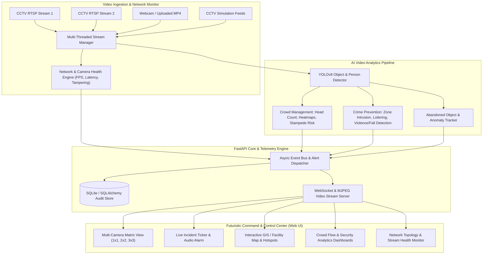

# 🛡️ AI Smart CCTV Surveillance & Network Command Center
### *Active Real-Time Crowd Management, Crime Prevention, and Network Health Monitoring*

Transform existing passive CCTV camera infrastructure into an **active, real-time AI surveillance, crowd safety, crime prevention, and network observability Command Center**.

---

## 🌟 Key Capabilities & Modules

### 👥 1. Intelligent Crowd Management & Safety
- **Real-Time Head / Person Counting**: Detects and tracks individuals continuously using YOLOv8 computer vision.
- **Dynamic Crowd Density Classification**: Dynamically categorizes density levels (`LOW`, `MODERATE`, `HIGH`, `CRITICAL_SURGE`).
- **Live Crowd Heatmaps**: Seamless gradient overlays illustrating high-congestion bottlenecks and dwell zones.
- **Stampede & Panic Surge Early Warning**: Monitors time-series derivatives of crowd density and acceleration to warn operators before bottlenecks turn hazardous.
- **Bi-directional Virtual Line Counter**: In/Out tripwire analytics measuring directional pedestrian flow rates.

### 🚨 2. Proactive Crime Prevention & Threat Detection
- **Restricted Zone Geo-Fencing**: Interactive polygon zone drawer allowing security operators to mark unauthorized or time-restricted areas.
- **Loitering Detection**: Flags subjects lingering in designated sensitive zones beyond configurable duration thresholds.
- **Violence / Physical Conflict Detection**: Pairwise proximity and motion flux heuristics to detect physical altercations in real time.
- **Fall & Medical Collapse Detection**: Bounding-box aspect ratio and downward trajectory analysis to alert security when sudden collapses occur.
- **Unattended Baggage / Object Left Behind**: Identifies stationary bags or boxes left isolated in public walkways.
- **Automated Incident Logging**: Saves forensic snapshot evidence with visual watermarks and provides exportable CSV audit trails.

### 🌐 3. CCTV Network Observability & Camera Health
- **Stream Performance Telemetry**: Real-time FPS, network bitrate (Mbps), and frame latency metrics.
- **Automated Tamper & Occlusion Detection**: Flags camera covering, spray paint, lens defocus/blur, blinding glare, or video signal loss.
- **Network Topology Visualizer**: Live health status indicators for all connected cameras, NVRs, and network gateways.

### 💻 4. Modern Glassmorphic SOC Command Center UI
- **Dark Defense/Cyber Ops Glassmorphism**: High-density visualization designed for multi-monitor command rooms.
- **Multi-Camera Matrix View**: 1x1, 2x2, and 3x3 layouts with toggleable AI annotations (Bounding Boxes, Heatmaps, Raw Optical feed).
- **Interactive GIS Facility Radar**: 2D floorplan/satellite map indicating camera coverage cones, live crowd levels, and active threat beacons.
- **Synthesized High-Tech Audio Alarm**: Web Audio API sirens and warning chimes without external dependencies.
- **Universal Input Support**: Works out-of-the-box with synthetic CCTV scenarios, live Webcams, RTSP streams, and custom MP4 video uploads.

---

## 🏗️ System Architecture



---

## 🚀 Quick Start Guide

### 1. Requirements
- Python 3.9+
- Modern Web Browser (Chrome, Edge, Firefox)

### 2. Launch the System
Run the single-click launcher:
```bash
python run_system.py
```
The server will automatically initialize the database, start background stream ingestion workers, and open the Command Center dashboard at:
👉 **`http://127.0.0.1:8000`**

Interactive API Docs:
👉 **`http://127.0.0.1:8000/docs`**

---

## 📡 REST & WebSocket API Reference

| Endpoint | Method | Description |
| :--- | :--- | :--- |
| `/api/cameras` | `GET` | List all cameras with active zone configurations |
| `/api/cameras` | `POST` | Add a new camera source (Simulation, Webcam, RTSP, Video) |
| `/api/cameras/{id}/stream` | `GET` | Live MJPEG video stream (`mode=processed\|raw\|heatmap`) |
| `/api/cameras/{id}/zones` | `POST` | Create a restricted polygon zone |
| `/api/incidents` | `GET` | Retrieve incident logs with severity/status filters |
| `/api/incidents/{id}/resolve` | `PUT` | Mark security incident as resolved/acknowledged |
| `/api/incidents/export/csv` | `GET` | Download full forensic incident audit log in CSV format |
| `/api/analytics/overview` | `GET` | Summary KPIs (Total crowd, active alerts, bandwidth, SLA) |
| `/api/analytics/crowd_trends` | `GET` | 24-hour occupancy time-series datasets |
| `/api/analytics/incident_breakdown`| `GET` | Incident category and severity breakdown |
| `/ws/telemetry` | `WebSocket` | Live telemetry stream & instant alert push notifications |

---

## ⚙️ Configuration & Customization
System defaults can be adjusted in [`backend/app/config.py`](file:///backend/app/config.py):
- `CROWD_HIGH_THRESHOLD`: Crowd surge alert limit (Default: 20 persons)
- `LOITERING_TIME_THRESHOLD_SEC`: Dwell duration before loitering alert (Default: 10.0s)
- `TAMPER_BLUR_THRESHOLD`: Laplacian variance threshold for lens occlusion (Default: 45.0)
- `ALERT_COOLDOWN_SEC`: Cooldown period between duplicate alerts (Default: 8.0s)
